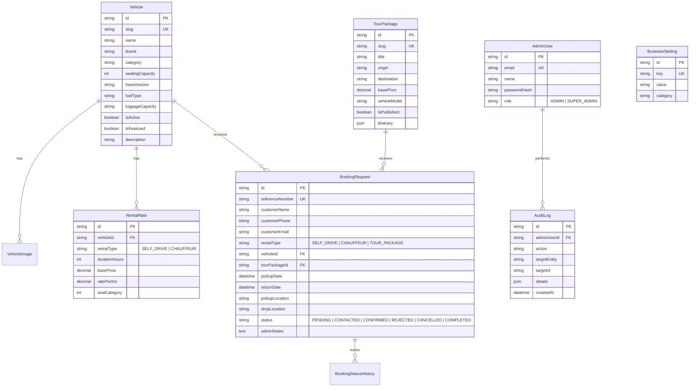

# ARCHITECTURE — छिंद धाम TOUR TRAVELS

## System Overview
**छिंद धाम TOUR TRAVELS** is architected as a robust, modular monolith built on Next.js (App Router), React, TypeScript, and Prisma ORM with PostgreSQL. It delivers both a high-performance public customer-facing travel web portal and an authenticated, role-protected administrative management platform.

---

## Architectural Principles
1. **Single Source of Truth**: All vehicle specifications, pricing tariffs, pilgrimage tour packages, and business policies reside in PostgreSQL managed via Prisma. No hardcoded rates or inventory in UI code.
2. **Deterministic Booking Pipeline**: Booking requests enter with status `PENDING`. They are never represented to the user as confirmed until verified and moved through explicit administrative workflow transitions.
3. **Defense in Depth**:
   - Strict runtime input validation via Zod on all API and server action boundaries.
   - Server-enforced role and session verification for `/admin` routes and administrative APIs.
   - Rate limiting and bot mitigation on customer-facing submission endpoints.
   - Parameterized queries through Prisma to eliminate SQL injection.
   - Environment variables validated at startup.
4. **Pluggable Integration Adapters**: External systems (email dispatch, SMS/WhatsApp notifications, file storage) are abstracted behind interface adapters with fallback mock implementations for local offline development.
5. **Aesthetic Excellence & Accessibility**: Modern dark theme with blue-purple gradients, high contrast ratios, responsive mobile-first UI, semantic HTML, and zero fabricated testimonials or ratings.

---

## Layered Architecture

```mermaid
graph TD
  User[Public Web Visitor] -->|HTTPS| PublicApp[Next.js App Router (Public Pages)]
  Admin[Administrator] -->|HTTPS / Auth Session| AdminApp[Next.js App Router (/admin)]
  
  PublicApp -->|Client/Server Actions & API| ApiGateway[Route Handlers /api/v1/*]
  AdminApp -->|Authenticated Actions| AdminGateway[Route Handlers /api/v1/admin/*]
  
  ApiGateway --> ZodValidators[Zod Validation Layer]
  AdminGateway --> ZodValidators
  AdminGateway --> AuthGuard[Session / Role Guard]

  ZodValidators --> ServiceLayer[Application Domain Services]
  ServiceLayer --> RepoLayer[Prisma Repository Layer]
  ServiceLayer --> AdapterLayer[Notification & Storage Adapters]
  
  RepoLayer --> PostgreSQL[(PostgreSQL Database)]
  AdapterLayer --> WhatsAppApi[WhatsApp Click-to-Chat / Direct Link]
  AdapterLayer --> EmailProvider[Email Provider / Console Logger]
```

---

## Domain Modules & Responsibilities

| Module | Core Responsibilities |
|---|---|
| **Vehicles** | Catalogue management, specifications (seats, transmission, fuel, luggage), images, active/featured status. |
| **Pricing** | Chauffeur pricing rules (₹11/km 5-seater, ₹13/km 7-seater), self-drive durations (6h, 12h, 24h tariffs), "Contact for Price" fallback handling. |
| **Tour Packages** | Curated routes (Bhopal to Maihar, Bagalamukhi Dham, Navratri specials), publication lifecycle, itinerary metadata. |
| **Bookings** | Booking request intake, reference generation (`CDT-YYYYMMDD-XXXX`), status transitions (`PENDING` -> `CONTACTED` -> `CONFIRMED`/`REJECTED`/`CANCELLED` -> `COMPLETED`), status audit trail. |
| **Enquiries** | General contact inquiries, customer lead capture. |
| **Business Settings** | Contact info (Karan Kushwaha 9691345722, Akash Ahirwar 7400950207), Bhopal address, operating hours, policies. |
| **Audit** | Immutable logging of administrative state modifications for security compliance. |

---

## Database Schema Model Design (Prisma)



---

## Security Architecture
1. **Authentication**: Admin session using cryptographically signed HTTP-only cookies, verified against salted bcrypt password hashes.
2. **Access Control**: Role-based access control (RBAC). Public requests cannot mutate vehicle, package, or pricing schemas.
3. **Rate Limiting**: Sliding window rate-limiting for IP / session on public write endpoints (`/api/v1/bookings`, `/api/v1/contact`, `/api/v1/admin/login`).
4. **Data Protection**:
   - Zero hardcoded passwords or API keys in repository.
   - PII minimization: No identity docs collected without explicit operational compliance requirements.
   - Sensitive error details and stack traces stripped in production responses.
5. **Content Security Policy & Headers**: Security headers (`X-Frame-Options`, `X-Content-Type-Options`, `Referrer-Policy`, strict CSP) applied via Next.js middleware and configuration.
